# Financial

* [Overview](#overview)
    - [Domain](#domain)
    - [Architecture](#architecture)
    - [Modules](#modules)
    - [Flow](#flow)
    - [Use cases](#use-cases)
    - [Queries](#queries)
* [Installation](#installation)
    - [Repository](#repository)
    - [Configuration](#configuration)
    - [Usage](#usage)
    - [Tests](#tests)
* [Environment setup](#environment-setup)
    - [Ports](#ports)
    - [Environment variables](#environment-variables)
* [License](#license)

## Overview

Study project that applies Clean Architecture, Hexagonal Architecture, Domain-Driven Design, Event Sourcing, CQRS, and
Kafka to an accounting domain. A financial transaction registered in bookkeeping is stored as an event, published to
Kafka through change data capture, and consumed by account, which moves the amount from the debit account to the
credit account.

The application has no HTTP interface. Every use case runs as a console command inside the `app` container through a
`make` target, and the long-running `platform` process creates the topics, registers the Kafka Connect connector, and
runs the stream that feeds the account policies.

### Domain

The domain is **financial**, with the subdomain **accounting**: the process of recording the financial transactions of
a company. Accounting is split in two bounded contexts, each with one aggregate, as Figure 1 shows.

<p align="center">
  
  <br>
  <sub>Figure 1. The financial domain, its accounting subdomain, and its two bounded contexts.</sub>
</p>

**Bookkeeping** records the financial transactions: purchases, sales, receipts, and payments of a person or an
organization. The `Transaction` aggregate is event sourced. Its state is never stored as a row, only the events it
raised, appended to the `bookkeeping.transactions` event store with their sequence, revision, and aggregate identity.
Registering a transaction raises `TransactionRegistered`.

**Account** keeps the ledger accounts, in which the debits and credits of the transactions are classified and
summarized. The `AccountBalance` aggregate holds the balance of one account, and debiting or crediting it returns a new
balance. Account never calls bookkeeping. It learns about each transaction only from the `TransactionRegistered` event.

### Architecture

Each context follows the hexagonal architecture of Figure 2. The core knows nothing of the console, Kafka, or
PostgreSQL. It exposes ports: the console adapter drives it through the command bus, the Kafka stream adapter through
the event bus, which hands each event to its policies, and the driven adapters implement its output ports.

<p align="center">
  
  <br>
  <sub>Figure 2. Hexagonal architecture: driver adapters, ports, application and domain layers, driven adapters.</sub>
</p>

The code of each context is organized in the same five layers:

| Layer     | Responsibility                                                                                                     |
|:----------|:-------------------------------------------------------------------------------------------------------------------|
| `command` | Orders to run a business use case, and their handlers. A command usually results in events being emitted.          |
| `core`    | The domain model and its rules, independent of every other layer and of whatever triggers it.                      |
| `driven`  | Secondary adapters implementing the output ports of the core: repositories, the troubleshooting queue, the viewer. |
| `driver`  | Primary adapters translating a delivery mechanism into a core call: the console driver and the Kafka event mapper. |
| `query`   | Read models and how they are retrieved, apart from the write side, as CQRS prescribes.                             |

A policy is a driver that reacts to an event with a command. A policy that fails does not stop the stream: the event,
the policy, and the error go to the `account.troubleshoot` table, a troubleshooting queue in the manner of a
[dead letter queue](https://en.wikipedia.org/wiki/Dead_letter_queue), from which the policy can run again.

### Modules

```
application
┣ 📂account
┣ 📂bookkeeping
┣ 📂shared
┗ 📂starter
```

| Module        | Content                                                                                                                                            |
|:--------------|:---------------------------------------------------------------------------------------------------------------------------------------------------|
| `account`     | The account context.                                                                                                                               |
| `bookkeeping` | The bookkeeping context.                                                                                                                           |
| `shared`      | Building blocks, event sourcing, buses, and the database and Kafka infrastructure, with no business rule. Its content can be split into libraries. |
| `starter`     | Entry point, dependency wiring, database migrations, and the Kafka Connect connector definition.                                                   |

### Flow

The streaming uses [change data capture](https://en.wikipedia.org/wiki/Change_data_capture) over the database log, so
the command writes only to its own event store and nothing in the application publishes to Kafka. A Debezium connector
reads the PostgreSQL write-ahead log, keeps only the inserts of `bookkeeping.transactions`, and republishes each one as
an Avro record on the `financial.accounting.bookkeeping.transaction-registered` topic, with its schema in the Schema
Registry. The `AdjustBalancePolicy` of account consumes the topic and dispatches `AdjustBalance`.

<p align="center">
  
  <br>
  <sub>Figure 3. Communication of the Financial application, one transaction step by step.</sub>
</p>

<p align="center">
  
  <br>
  <sub>Figure 4. EventStorming view: the command that raises the domain event and the policy that reacts to it.</sub>
</p>

Sources: [financial-domain.html](docs/diagrams/financial-domain.html),
[financial-architecture.html](docs/diagrams/financial-architecture.html),
[financial-flow.html](docs/diagrams/financial-flow.html),
[financial-events.html](docs/diagrams/financial-events.html).

### Use cases

- [Financial transaction registering](docs/USE_CASES.md#financial-transaction-registering)
- [Balance adjusting](docs/USE_CASES.md#balance-adjusting)
- [Failures solving](docs/USE_CASES.md#failures-solving)

### Queries

- [Show balances](docs/QUERIES.md#show-balances)

## Installation

### Repository

To clone the repository using the command line, run:

```bash
git clone https://github.com/gustavofreze/financial.git
```

### Configuration

To install project dependencies and build the application jar, run:

```bash
make configure
```

To start the application containers, run:

```bash
make start
```

To stop the application containers and remove their network, run:

```bash
make stop
```

### Usage

To register a financial transaction, run:

```bash
make register-financial-transaction
```

To show the balances, run:

```bash
make show-balance
```

To run again the policies that failed, run:

```bash
make solve-failures
```

### Tests

Run all tests:

```bash
make tests
```

Run a specific test class:

```bash
make test-file FILE=AccountBalanceTest
```

> You can check other available commands by running `make help`.

## Environment setup

### Ports

| Container         | Host port      | Purpose                                     |
|:------------------|:---------------|:--------------------------------------------|
| `app`             | `8080`         | Application                                 |
| `postgresql`      | `5432`         | PostgreSQL with logical decoding (Debezium) |
| `zookeeper`       | `2181`         | ZooKeeper                                   |
| `broker`          | `9000`, `9001` | Kafka, internal and host listeners          |
| `schema-registry` | `8081`         | Confluent Schema Registry                   |
| `kafka-connect`   | `8083`         | Kafka Connect with the Debezium connector   |

### Environment variables

Every variable the application and its migration run read. This is a study project, so `config/configs.env` is
committed and the `Development value` column below is the literal content of that file. Every value in it is a
local-only default and never a real credential. Docker Compose loads the file into the `app` container through
`env_file`.

| Variable                        | Description                                                  | Development value                                                                     |
|:--------------------------------|:-------------------------------------------------------------|:--------------------------------------------------------------------------------------|
| `TOPICS`                        | Comma-separated topics the platform creates at startup       | `financial.accounting.bookkeeping.transaction-registered`                             |
| `APPLICATION_ID`                | Kafka Streams application id                                 | `financial`                                                                           |
| `BOOTSTRAP_SERVERS`             | Kafka bootstrap servers                                      | `broker:9000`                                                                         |
| `KAFKA_CONNECT_URL`             | Kafka Connect REST endpoint the connectors are registered at | `http://kafka-connect:8083`                                                           |
| `SCHEMA_REGISTRY_URL`           | Schema Registry endpoint                                     | `http://schema-registry:8081`                                                         |
| `KAFKA_CONNECT_CONNECTORS_PATH` | Directory the connector definitions are read from            | `/opt/data/kafka/connectors`                                                          |
| `POSTGRESQL_DATABASE_USER`      | Least-privilege user the application connects as             | `financial_app`                                                                       |
| `POSTGRESQL_DATABASE_PASSWORD`  | Password of the application user                             | `fC8&wsPuF7qZ`                                                                        |
| `POSTGRESQL_DATABASE_JDBC_URL`  | JDBC URL of the application database                         | `jdbc:postgresql://postgresql:5432/financial_adm?stringtype=unspecified`              |
| `TEST_DATABASE_USER`            | User of the in-memory test database                          | `test`                                                                                |
| `TEST_DATABASE_PASSWORD`        | Password of the in-memory test database                      | `test`                                                                                |
| `TEST_DATABASE_JDBC_URL`        | JDBC URL of the in-memory H2 test database                   | `jdbc:h2:mem:financial_adm`                                                           |
| `FLYWAY_URL`                    | JDBC URL the migration run connects to                       | `jdbc:postgresql://postgresql:5432/financial_adm`                                     |
| `FLYWAY_USER`                   | Database owner the migration run connects as                 | `postgres`                                                                            |
| `FLYWAY_TABLE`                  | Table Flyway keeps its schema history in                     | `schema_history`                                                                      |
| `FLYWAY_SCHEMAS`                | Schemas Flyway manages                                       | `system,account,bookkeeping`                                                          |
| `FLYWAY_PASSWORD`               | Password of the database owner                               | `postgres`                                                                            |
| `FLYWAY_LOCATIONS`              | Directory the migration files are read from                  | `filesystem:/opt/data/application/starter/src/main/resources/db/postgresql/migration` |
| `FLYWAY_DEFAULT_SCHEMA`         | Schema the history table lives in                            | `system`                                                                              |
| `FLYWAY_CONFIG_FILE_ENCODING`   | Encoding of the migration files                              | `UTF-8`                                                                               |

## License

Financial is licensed under [MIT](LICENSE).
