# Financial

* [Overview](#overview)
    - [Domain](#domain)
    - [Architecture](#architecture)
    - [Modules](#modules)
    - [Infrastructure](#infrastructure)
    - [Flow](#flow)
    - [Data model](#data-model)
    - [Use cases](#use-cases)
    - [Queries](#queries)
* [Installation](#installation)
    - [Repository](#repository)
    - [Configuration](#configuration)
    - [Usage](#usage)
    - [Tests](#tests)
    - [Review](#review)
    - [Reports](#reports)
* [Environment setup](#environment-setup)
    - [Ports](#ports)
    - [Environment variables](#environment-variables)
* [License](#license)

## Overview

Study project that applies Clean Architecture, Hexagonal Architecture, Domain-Driven Design, Event Sourcing, CQRS, and
Kafka to an accounting domain. A financial transaction registered in bookkeeping is stored as an event, published to
Kafka through change data capture, and consumed by account, which moves the amount from the debit account to the
credit account.

The application has no HTTP interface. Every use case runs as a console command inside the `app` container through a
`make` target, and the long-running `platform` process creates the topics, registers the Kafka Connect connector, and
runs the stream that feeds the account policies.

### Domain

The domain is **financial**, with the subdomain **accounting**: the process of recording the financial transactions of
a company. Accounting is split in two bounded contexts, each with one aggregate, as Figure 1 shows.

<p align="center">
  
  <br>
  <sub>Figure 1. The financial domain, its accounting subdomain, and its two bounded contexts.</sub>
</p>

**Bookkeeping** records the financial transactions: purchases, sales, receipts, and payments of a person or an
organization. The `Transaction` aggregate is event sourced. Its state is never stored as a row, only the events it
raised, appended to the `bookkeeping.transactions` event store with their sequence, revision, and aggregate identity.
Registering a transaction raises `TransactionRegistered`.

**Account** keeps the ledger accounts, in which the debits and credits of the transactions are classified and
summarized. The `AccountBalance` aggregate holds the balance of one account, and debiting or crediting it returns a new
balance. Account never calls bookkeeping. It learns about each transaction only from the `TransactionRegistered` event.

### Architecture

Each context follows the hexagonal architecture, one hexagon per context, as Figures 2 and 3 show. The application
knows nothing of the console, Kafka, or PostgreSQL. It exposes ports: the console adapter calls its inbound ports, the
Kafka stream adapter of account hands each event to the policies through the event bus, and the driven adapters
implement its outbound ports.

<p align="center">
  
  <br>
  <sub>Figure 2. Bookkeeping hexagon: the console adapter, the ports, the event store and notices, and the event publication.</sub>
</p>

<p align="center">
  
  <br>
  <sub>Figure 3. Account hexagon: the console and stream adapters, the ports, the repositories and notices, and the query slice.</sub>
</p>

The code of each context is organized in the same four layers:

| Layer         | Responsibility                                                                                                       |
|:--------------|:---------------------------------------------------------------------------------------------------------------------|
| `application` | The commands, their handlers, the inbound and outbound ports, and the `domain` with its models, events and failures. |
| `driven`      | Secondary adapters implementing the outbound ports: the repositories, the troubleshooting queue, and the notices.    |
| `driver`      | Primary adapters calling an inbound port: the console commands and the policies the event bus tells.                 |
| `query`       | Read slices with their read port, read model, database adapter and console, apart from the write side (CQRS).        |

A policy is a driver that reacts to an event with a command. A policy that fails does not stop the stream: the event,
the policy, and the error go to the `account.troubleshoot` table, a troubleshooting queue in the manner of a
[dead letter queue](https://en.wikipedia.org/wiki/Dead_letter_queue), from which the policy can run again.

### Modules

```
application
┣ 📂account
┣ 📂bookkeeping
┣ 📂shared
┗ 📂starter
```

| Module        | Content                                                                                                                                     |
|:--------------|:--------------------------------------------------------------------------------------------------------------------------------------------|
| `account`     | The account context.                                                                                                                        |
| `bookkeeping` | The bookkeeping context.                                                                                                                    |
| `shared`      | The shared value objects, the event bus port, and the console, database, JSON, log and Kafka adapters, the only place a framework is named. |
| `starter`     | Entry point, dependency wiring, database migrations, and the Kafka Connect connector definition.                                            |

### Infrastructure

The application runs in the `app` container beside the containers of Figure 4. PostgreSQL runs with
`wal_level=logical`, so every insert reaches its write-ahead log, the PostgreSQL counterpart of a MySQL binlog. Kafka
Connect decodes that log through Debezium, with the `pgoutput` plugin and the `dbz_publication` publication, and
publishes to Kafka with the schemas in Schema Registry. The migrations run once, in `financial-migrate`, before `app`
starts.

<p align="center">
  
  <br>
  <sub>Figure 4. Infrastructure: the app, the migration, PostgreSQL and its write-ahead log, Kafka Connect, Kafka, and Schema Registry.</sub>
</p>

### Flow

The streaming uses [change data capture](https://en.wikipedia.org/wiki/Change_data_capture), so the command writes
only to its own event store and nothing in the application publishes to Kafka. Debezium keeps only the inserts of
`bookkeeping.transactions` and republishes each one as an Avro record on the
`financial.accounting.bookkeeping.transaction-registered` topic. The `AdjustBalancePolicy` of account consumes the
topic and adjusts both balances through the `BalanceAdjusting` port.

<p align="center">
  
  <br>
  <sub>Figure 5. One application with two bounded contexts, one transaction step by step.</sub>
</p>

<p align="center">
  
  <br>
  <sub>Figure 6. EventStorming view: the command, the domain event, the policy, the failure replay and the read model.</sub>
</p>

### Data model

Each context owns one PostgreSQL schema, and no foreign key crosses them, as Figure 7 shows.

<p align="center">
  
  <br>
  <sub>Figure 7. Data model: the event store of bookkeeping, and the balances, adjustments and troubleshooting of account.</sub>
</p>

Sources: [financial-domain.html](docs/diagrams/financial-domain.html),
[financial-architecture-bookkeeping.html](docs/diagrams/financial-architecture-bookkeeping.html),
[financial-architecture-account.html](docs/diagrams/financial-architecture-account.html),
[financial-infrastructure.html](docs/diagrams/financial-infrastructure.html),
[financial-flow.html](docs/diagrams/financial-flow.html),
[financial-events.html](docs/diagrams/financial-events.html),
[financial-data-model.html](docs/diagrams/financial-data-model.html).

### Use cases

- [Financial transaction registering](docs/USE_CASES.md#financial-transaction-registering)
- [Balance adjusting](docs/USE_CASES.md#balance-adjusting)
- [Failures solving](docs/USE_CASES.md#failures-solving)

### Queries

- [Show balances](docs/QUERIES.md#show-balances)

## Installation

### Repository

To clone the repository using the command line, run:

```bash
git clone https://github.com/gustavofreze/financial.git
```

### Configuration

To install project dependencies, run:

```bash
make configure
```

To update project dependencies, run:

```bash
make configure-and-update
```

To start the application containers, run:

```bash
make start
```

To stop the application containers and drop the data volume, run:

```bash
make stop
```

### Usage

To register a financial transaction, run:

```bash
make register-financial-transaction
```

To show the balances, run:

```bash
make show-balance
```

To run again the policies that failed, run:

```bash
make solve-failures
```

### Tests

Run all tests with coverage and mutation testing:

```bash
make tests
```

Run a specific test file without coverage:

```bash
make test-file FILE=ClassNameTest
```

### Review

Run static code analysis:

```bash
make review
```

Fix what static code analysis can correct:

```bash
make fix-review
```

### Reports

Open coverage and mutation reports in the browser:

```bash
make show-reports
```

Show outdated dependencies:

```bash
make show-outdated
```

> You can check other available commands by running `make help`.

## Environment setup

### Ports

| Container           | Image                                               | Host port      | Purpose                                          |
|:--------------------|:----------------------------------------------------|:---------------|:-------------------------------------------------|
| `app`               | `debian:13.8-slim` with a jlink Java 27 runtime     | none           | The platform and the console                     |
| `financial-migrate` | `flyway/flyway:13.13.0-alpine`                      | none           | Runs the migrations once, then exits             |
| `postgresql`        | `postgres:18.7`                                     | `5432`         | PostgreSQL with logical decoding for Debezium    |
| `broker`            | `confluentinc/cp-kafka:8.4.1`                       | `9000`, `9001` | Kafka in KRaft mode, internal and host listeners |
| `schema-registry`   | `confluentinc/cp-schema-registry:8.4.1`             | `8081`         | Confluent Schema Registry                        |
| `kafka-connect`     | `confluentinc/cp-kafka-connect:8.4.1` with Debezium | `8083`         | Kafka Connect with the Debezium connector        |

### Environment variables

`config/configs.env` is committed with local-only defaults, never a real credential, and Docker Compose loads it into
the `app`, `financial-migrate`, and `postgresql` containers through `env_file`.

| Variable                        | Description                                                  | Development value                                                                     |
|:--------------------------------|:-------------------------------------------------------------|:--------------------------------------------------------------------------------------|
| `TOPICS`                        | Comma-separated topics the platform creates at startup       | `financial.accounting.bookkeeping.transaction-registered`                             |
| `APPLICATION_ID`                | Kafka Streams application id                                 | `financial`                                                                           |
| `BOOTSTRAP_SERVERS`             | Kafka bootstrap servers                                      | `broker:9000`                                                                         |
| `KAFKA_CONNECT_URL`             | Kafka Connect REST endpoint the connectors are registered at | `http://kafka-connect:8083`                                                           |
| `SCHEMA_REGISTRY_URL`           | Schema Registry endpoint                                     | `http://schema-registry:8081`                                                         |
| `KAFKA_CONNECT_CONNECTORS_PATH` | Directory the connector definitions are read from            | `/opt/data/kafka/connectors`                                                          |
| `POSTGRES_DB`                   | Database the PostgreSQL container creates at first start     | `financial_adm`                                                                       |
| `POSTGRES_USER`                 | Superuser of the PostgreSQL container                        | `postgres`                                                                            |
| `POSTGRES_PASSWORD`             | Password of the PostgreSQL superuser                         | `postgres`                                                                            |
| `POSTGRESQL_DATABASE_USER`      | Least-privilege user the application connects as             | `financial_app`                                                                       |
| `POSTGRESQL_DATABASE_PASSWORD`  | Password of the application user                             | `fC8&wsPuF7qZ`                                                                        |
| `POSTGRESQL_DATABASE_JDBC_URL`  | JDBC URL of the application database                         | `jdbc:postgresql://postgresql:5432/financial_adm?stringtype=unspecified`              |
| `FLYWAY_URL`                    | JDBC URL the migration run connects to                       | `jdbc:postgresql://postgresql:5432/financial_adm`                                     |
| `FLYWAY_USER`                   | Database owner the migration run connects as                 | `postgres`                                                                            |
| `FLYWAY_TABLE`                  | Table Flyway keeps its schema history in                     | `schema_history`                                                                      |
| `FLYWAY_SCHEMAS`                | Schemas Flyway manages                                       | `system,account,bookkeeping`                                                          |
| `FLYWAY_PASSWORD`               | Password of the database owner                               | `postgres`                                                                            |
| `FLYWAY_LOCATIONS`              | Directory the migration files are read from                  | `filesystem:/flyway/sql`                                                              |
| `FLYWAY_DEFAULT_SCHEMA`         | Schema the history table lives in                            | `system`                                                                              |

## License

Financial is licensed under [MIT](LICENSE).
